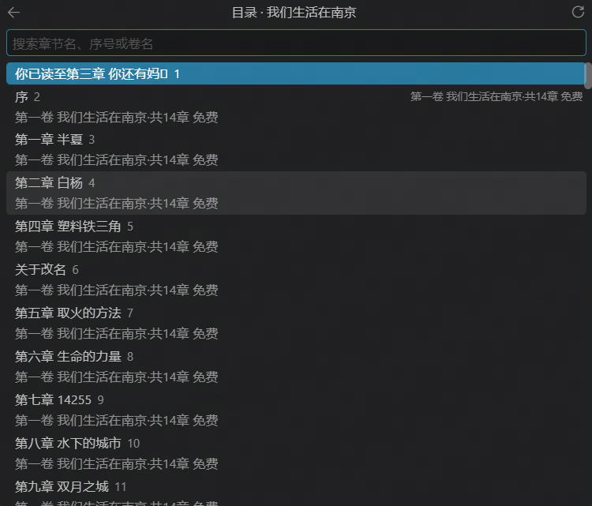

# IdlePage / 余页

A discreet VS Code novel reader with status bar reading, online book sources, account authentication, and practice cards from any idlepage/1 server.

自用 VS Code 小说阅读器，通过普通 Edge 中的浏览器伴随扩展接入起点中文网。账号登录由用户在官方页面完成，书架、目录和正文读取由 VS Code 发起，在 VS Code 中查看结果。


*状态栏阅读与功能菜单，首次连接设置也在此进入。*



*按章节名、序号或卷名搜索，选择章节开始阅读。*

## 功能

- 获取当前页书架书单和书籍目录。
- 获取当前账号可读取的章节正文，过滤段落评论计数。
- 状态栏按“当前章/总数 · 正文 · 本章百分比”阅读，支持翻段、下一章及隐藏/恢复；获取失败保留原文和位置。
- 自动串行缓存当前章之后的 3 章；前进一章只补齐新的缺口，已缓存内容不重复访问。
- 正文统一区分可获取与不可获取，对登录失效、内容限制或读取错误显示提醒。
- 按读取任务自动唤起专用 Edge，使用浏览器保存的登录会话连接。
- 读取时自动隐藏专用浏览器窗口，保留手动显示和隐藏入口。
- 接入和书架登录流程可以显示浏览器并确认后恢复；正文阅读或后台预取失败时，改在状态栏提示，由用户显示浏览器检查。
- 已确认的书架页独立保留；阅读任务页稳定时一个、过渡最多两个，失败页保留供手动检查。
- 本地保存书籍、卷、章节及已获取正文的映射；再次阅读优先使用缓存，未命中时按需在线获取。
- 底部书本图标悬停展开功能链接，使用原生搜索列表选择书籍与章节；阅读区域可以单独隐藏。
- 练习：连接任意支持 idlepage/1 协议的网站，在状态栏刷它的题（例如单词卡、练耳选择题），进度记在网站自己的账号上；登录沿用网站本身的登录页。

目录的免费或付费标记仅供参考，可读性以账号在官方页面实际能够获取的正文为准。插件不执行购买、订阅或条件解锁；遇到访问验证时停止任务并提醒。

## 环境要求

- Windows、桌面版 VS Code 和 Microsoft Edge。
- 从源码运行需要 Node.js 22+ 和 npm。
- 一个用于运行 IdlePage 本机服务的 VS Code 窗口。

## 安装

也可以直接安装 Release 中的 `.vsix`：VS Code 扩展页 → `…` → **从 VSIX 安装**，选中下载的文件，安装后按提示重载。此方式不需要 Node.js。随后按下文“首次连接设置”连接专用浏览器。

VSIX 已内置浏览器扩展模板，插件会生成本机配对版本并在启动专用 Edge 时自动加载，无需另行下载或手动安装。

## 从源码运行

```powershell
npm ci
npm run build
```

在 VS Code 中打开项目，按 F5 并选择 **Run IdlePage**。后续命令在新打开的扩展开发窗口中执行。

## 首次连接设置

阅读和自定义网站共用一个专用 Edge 和其中的配套浏览器扩展。扩展由插件在启动专用 Edge 时自动加载，不需要在 Edge 里手动安装，也不需要开启开发人员模式；插件更新后扩展会自动换成新版本。设置不访问任何网站，也不需要登录。

1. 悬停底部书本图标，点击 **首次连接设置 / 重新设置**。插件会（重新）启动专用 Edge 并加载配套扩展。
2. 扩展连上后显示“设置 2/2：已连接”，设置完成。

专用 Edge 是一个独立的空白配置：不登录 Edge 账号、不开同步，与你平时用的 Edge 互不影响。

设置流程最多等待 10 分钟，超时停止。悬停可取消设置；重新运行设置不会清除登录和缓存。命令面板中的 `IdlePage: 准备浏览器连接` 仍可启动同一引导流程。

## 接入起点中文网

登录是按需的：悬停书本图标，“阅读”区域在登录前只有 **登录起点**。点击后专用 Edge 显示起点页面，手动登录后自动读取书架并打开书架列表；之后这一区域才出现进入书架、刷新、隐藏/恢复阅读等项目。选择书籍 → 选择章节即可阅读。

辅助扩展只需首次安装。读取任务会自动唤起浏览器、连接并隐藏专用窗口；任务标签页默认不激活。接入登录流程可以显示浏览器，正文和预取失败则通过状态栏提供手动显示入口。主动显示排查时保持可见。关闭 VS Code 服务窗口时会回收专用浏览器及其生命周期辅助进程，普通 Edge 不受影响；再次运行插件并发起任务即可重新连接。

## 自定义网站（idlepage/1 练习）

余页可以连接任何发布了 `/.well-known/idlepage.json`（idlepage/1 协议）的网站，在状态栏做该网站上某个练习页的题，例如单词卡或练耳选择题。悬停书本图标，在“自定义网站”区域操作：

1. **添加网址**：点区域末尾的 **添加网址**，填网站上某个练习页的网址，例如 `https://example.com/tools/music/ear-training/`；只填网站根地址则列出全站可练的题库。最多 6 个，保存在设置 `idlepage.remote.servers`。
2. 每个网址占一行：先显示简短的名字（网址最后一段，如 `ear-training`；鼠标停在名字上显示完整网址，点名字即登录或开始练习），后面是它的操作。未登录时是 **登录**；登录后显示账号，以及 **练习**、**登出**。行末的 ✎ 修改网址、🗑 删除这一行（不影响网站上的进度）。同一网站的几个练习页共用一次登录。
3. **登录**：专用 Edge 显示该网站自己的登录页，登录后自动隐藏浏览器；浏览器里已有会话时直接认出账号。插件不保存账号、密码或 Cookie。
4. **练习**：点哪一行就练哪个页面；该页面只有一个题库时直接开始，否则先选题库，有单元的再选单元或“混合练习”。练习中点另一行会先结束当前这组（已答部分照常提交）。
5. **登出**只退出这个网站的会话；网站若用其他账号系统（如 Gitea）登录，那边可能仍保持登录，再次登录时会直接回来。

练习直接铺在书本图标右侧的状态栏上，和看小说一样不用悬停：进度（如 `3/10`）、题面、每个选项或打分按钮各是一项，点一下即可。

- **选择题**：直接点选项（①②③… 是序号），或按 `Alt+1`～`Alt+9`。节奏题的选项是鼓机式网格，如 `◆◇◇◇ ◆◇◆◇ ◆◇◇◇ ◇◇◇◇`：每组四格是一拍，◆ 是出声、◇ 是不出声。答完同一位置显示对错与解析，点 **下一题** 或按 `Alt+.` 继续。
- **自评卡**：先回想，点 **翻开**（`Alt+.`），再点打分按钮（`Alt+1`～`Alt+4`）；标为“不认识/模糊”的卡在本组稍后再出。
- **声音**：练耳的钢琴、单词的读音都由网站自己的页面在专用 Edge 后台播放（和网页上听到的一样）；出题或翻开时自动播放，点题面或 🔊（`Alt+,`）再听一遍。网站没有提供播放页面时不出声，练习照常。
- 一组结束自动交卷，状态栏显示网站给出的小结，可点 **再来一组** 或 **换**；点 ✕ 结束练习，已答部分也会提交。点进度项可重新选择题库或单元。

快捷键只在练习进行中生效，可在“配置快捷键”中修改。网站上只能在网页里做的题型（例如听写）不会出现在插件里。

## 命令

日常从底部书本图标的悬停菜单进入：

- **进入书架**：搜索当前页书籍，选择后进入目录；目录支持章节名、序号和卷名搜索，顶部返回箭头回到书架，刷新按钮在线更新当前列表。选章后获取正文，成功后更新当前阅读标记。按 Esc 只收起列表，停止读取请使用“取消当前任务”。
- **显示专用浏览器／隐藏**：控制已运行的专用 Edge；尚未启动时，可先获取未缓存内容或执行全部刷新。
- **刷新书架**：在线更新当前页书单并打开书架列表。复用已运行的专用浏览器；未启动时才冷启动，首次可能短暂显示窗口。保留登录和阅读缓存。
- **全部刷新**：停止旧任务，关闭专用浏览器全部标签并重开，在线重新获取当前页书架。保留登录会话、正文缓存及当前已读位置；普通 Edge 不受影响。这不会下载所有书籍正文。
- **设置**：打开余页设置；有任务时菜单还会显示取消入口。

悬停菜单位置由 VS Code 决定，通常出现在图标上方。书本入口不绑定单击或双击操作，不添加活动栏图标。正常选章后直接在状态栏阅读；旧正文预览命令仍可用于排查。

## 状态栏阅读

左侧显示 `当前章/总数`，中间正文，右侧显示本章进度。正文内部使用相邻原生项目，避免单项宽度上限裁掉尾文，点击任一正文部分均翻到下一段。第一段为 `0%`，最后一段为 `100%`（全文只有一段时仍从 `0%` 开始）。进度按正文字符位置计算，调整宽度不会重置阅读位置。

正文联合规划当前屏及下一屏的切分，优先在段落、句末及标点后停顿，允许适当留白，并尽量避免孤立短块、拆开数字、英文单词或句末引号。调整窗口宽度保留当前显示起点，不回退到新的分页开头；原生项目间的间隔仍由 VS Code 管理。

- 单击正文或 `Alt+→`：下一段，到本章末尾后获取下一章。
- `Alt+←`：上一段；`Alt+↓`：下一章。
- `Alt+H`：隐藏/恢复阅读，书本菜单也提供入口。快捷键可在 VS Code 中重新绑定。
- `idlepage.reading.widthPercent`：正文容量按窗口总宽度百分比估算，默认 60%，可调 10%–80%，即时生效。原生状态栏无法设置精确宽度；字体、缩放及其他项目会影响实际占用，未测到窗口宽度前使用保守估算。

后台以当前章后三章为预取目标，末尾不足三章按剩余章节处理。正文首次加载、续读、下一章和后台预取均允许跳过一章失败：只再尝试紧邻的下一章，成功后在状态栏提示被跳过的章节名；连续两章失败或已到目录末尾才停止并显示错误。若预取目标的最后一章失败，最多向外多尝试一章，不扩展为整本下载。后台跳过不会改变当前阅读位置，也不会缓存失败内容。取消操作、缓存无法写入不触发顺延。

首次启动 Edge 可能短暂显示；已运行时复用隐藏窗口。失败停止后，点击提醒可显示浏览器检查；“返回阅读”恢复原文和位置，并隐藏主动显示的浏览器，不自动重试。需要继续时使用提示中的“重试”或书本菜单中的“重试预取”。

后三章缓存按原容量限制管理；缓存关闭或容量不足时会提示，插件不会绕过该设置。

阅读进度自动保存到本机：每本书记录上次章节和正文字符位置，选书后的目录首项为 **继续阅读**，下方仍是完整章节目录。直接选择普通章节从章首开始；选择继续阅读恢复上次位置。

重启 VS Code 后不会自动展开正文或启动浏览器。按 `Alt+H`（或你换绑后的隐藏/恢复快捷键），或点击书本菜单的 **隐藏/恢复阅读**，即可续读最后一本书。优先读取本地目录和正文缓存，缺少缓存时自动在线获取；原章节失败但下一章成功时，从下一章章首继续并提示，连续失败则保留原书签。进度与正文缓存独立保存，正文被淘汰不会删除书签；最多保留最近 300 本书的记录，正常退出会等待进度写入完成。

`idlepage.reading.leftOffsetPercent` 控制状态栏阅读区的左侧偏移占比（0–100，默认 0）：0% 靠左，100% 靠右，中间值在估算的剩余空间内移动。例如正文显示占比 70%、左侧偏移 100%，章节号、正文和进度会一起靠近右侧状态栏项目。修改立即生效，不改变阅读位置；书本菜单入口仍在左侧。原生状态栏无法精确测量其他项目宽度，中间位置会受字体、缩放及其他按钮影响；窗口较窄时自动减少留白。此设置不影响侧栏和底部面板。

| 命令 | 用途 |
|---|---|
| `余页: 进入书架` | 打开书架和目录搜索选择列表 |
| `余页: 全部刷新` | 关闭专用浏览器全部标签，重开并在线刷新当前页书架 |
| `余页: 刷新书架` | 复用专用浏览器，在线更新当前页书单 |
| `余页: 设置` | 打开本扩展设置 |
| `IdlePage: 准备浏览器连接` | 打开扩展管理页，复制配对目录 |
| `IdlePage: 查看接入状态` | 查看连接和页面访问状态 |
| `IdlePage: 显示辅助浏览器` | 显示已运行的专用 Edge，进入排查状态 |
| `IdlePage: 隐藏辅助浏览器` | 隐藏已运行的专用 Edge，恢复自动管理模式 |
| `IdlePage: 取消当前获取或登录等待` | 停止任务，保留已读正文和位置，忽略迟到结果 |
| `IdlePage: 重新验证接入` | 发起首页与书架访问任务 |
| `IdlePage: 测试当前页书单提取` | 获取当前页书单 |
| `IdlePage: 查看当前页书单` | 显示本次书单 |
| `IdlePage: 测试第一本书目录` | 获取当前页书单第一本书的目录 |
| `IdlePage: 查看本次目录` | 显示本次目录 |
| `IdlePage: 测试第一章正文获取` | 获取当前目录第一章正文 |
| `IdlePage: 查看本次正文结果` | 显示正文或不可获取原因 |
| `IdlePage: 下一章` | 按目录顺序获取下一章 |

## 设置与连接排查

显示和隐藏命令仅控制 IdlePage 专用 Edge，不会关闭浏览器或启动新窗口。专用浏览器尚未运行时，请先发起读取任务或运行“准备浏览器连接”。主动显示后保留排查状态，执行隐藏命令可退出该状态。

登录等待最多 10 分钟；完成官方登录后，插件会确认个人书架内容或明确的已登录控件，再恢复本次书籍/章节目标。仅关闭登录弹窗不会恢复任务。同一次任务最多自动恢复一次；仍要求登录、访问受阻或在线读取超时会停止并提醒，原正文保留。取消后需重新发起读取命令。主动显示的排查模式仍会保持可见。

| 设置 | 默认值 | 说明 |
|---|---|---|
| `idlepage.bridge.port` | `17655` | 本机服务端口；修改后重启插件并重新加载同一配对目录 |
| `idlepage.browser.autoStart` | `true` | 发起读取任务时自动唤起专用 Edge |
| `idlepage.browser.autoHide` | `true` | 读取任务中自动隐藏专用 Edge；可关闭以保持浏览器可见 |
| `idlepage.cache.enabled` | `true` | 启用本地阅读缓存；修改后重启插件 |
| `idlepage.cache.maxSizeMB` | `200` | 缓存容量，单位 MiB；修改后立即执行容量整理 |
| `idlepage.remote.servers` | 空 | 练习网址列表（idlepage/1 网站上的练习页或网站根地址，最多 6 个），只保存在本机、不参与设置同步；修改后浏览器扩展会自动取得这些网站的访问权限 |

缓存容量包含数据和索引，超额时优先淘汰最久未使用的章节正文，再淘汰元数据；原子写入期间会有短暂临时文件。仅缓存成功获取的完整结果，不自动预下载整本书。章节页会标明“在线获取”或“本地缓存”。需要更新书架或目录时，重新执行对应提取命令。任务页管理不包括伴随扩展状态页和用户自行打开或导航的页面。

连接失败时，先确认 VS Code 服务窗口运行中，以及专用 Edge 中的伴随扩展已安装并启用。伴随页的 `connectionError` 可帮助排查：

- `BridgeStatus401`：配对凭据不匹配。
- `BridgeStatus403`：来源检查失败。
- `BridgeTimeout` / `BridgeNetworkError`：本机服务超时或不可达。

## 本机数据

网站登录会话保存在专用 Edge 配置中，插件不读取或导出 Cookie。本机服务仅监听 `127.0.0.1`，使用配对扩展来源和密钥校验连接。

专用浏览器配置位于 `%LOCALAPPDATA%/IdlePage/edge-profile/`（不登录 Edge 账号、不同步；早期版本使用的 `%LOCALAPPDATA%/IdlePage/qidian-probe/` 已不再使用，确认不需要其中的登录后可以删除）；配对文件由插件生成在 VS Code 私有存储目录。请勿上传浏览器配置、配对文件或 `.local/` 中的数据。

结构化阅读缓存位于该 VS Code 配置的 `globalStorage/myosotis0v0.idle-page/reading-cache/`，仅保存在本机，不同步到 Git。源码测试窗口使用 `.local/vscode-live-user/User/globalStorage/` 下的独立存储。关闭服务窗口后可删除 `reading-cache` 目录清空缓存，不影响浏览器登录会话。

开发方案、验证证据、进度和待办统一见 [方案与进度](docs/PLAN.md)。
# 文本显示位置

统一隐藏/恢复阅读默认使用 `Alt+H`，适用于状态栏、侧栏和底部面板，在 VS Code 输入框聚焦时也可使用。隐藏时 Webview 阅读视图一并收起，保留其他视图；恢复保留当前章节和偏移。后台结果不会自动解除隐藏。它是 VS Code 内快捷键，不是系统全局热键，也不会关闭专用浏览器。

所有正式阅读快捷键使用 VS Code 原生可配置绑定：悬停书本 → **配置快捷键**，双击对应命令即可修改、删除或添加绑定。列表使用 `idlepage` 搜索，同时显示默认和用户自定义绑定，改绑后仍可继续修改。默认上一段 `Alt+←`、下一段 `Alt+→`、下一章 `Alt+↓`、隐藏/恢复 `Alt+H`。未设置默认按键的书架、显示位置、重试等命令也可自行绑定；冲突以 VS Code 键盘快捷方式界面的提示为准。

侧栏与底部面板支持正文区域滚轮翻段：向下下一段、向上上一段；鼠标在工具栏、其他视图或正文区域之外时不响应。连续滚动会节流。正文溢出时先滚动查看，到边缘停顿后再滚动才翻段；隐藏或读取失败时停用。Ctrl 等修饰键滚轮不触发翻段。

悬停状态栏的书本图标，点击一级菜单中的“文本显示位置”，在列表中选择：

- **状态栏**：原有章节号、分段正文与进度显示，默认选项。
- **侧栏阅读区**：与 Codex 视图上下排列；未安装 Codex 时放入资源管理器，可拖动视图标题调整位置。
- **底部面板**：在编辑器下方的“余页”面板阅读。

选择保存在用户设置 `idlepage.reading.location`，切换时保留章节与阅读进度，不重新获取正文。三种位置使用同一套翻段、下一章和隐藏/恢复命令；Webview 可滚动查看当前段落。读取失败仍在状态栏提醒，Webview 同时提供显示浏览器、返回阅读和重试按钮。
